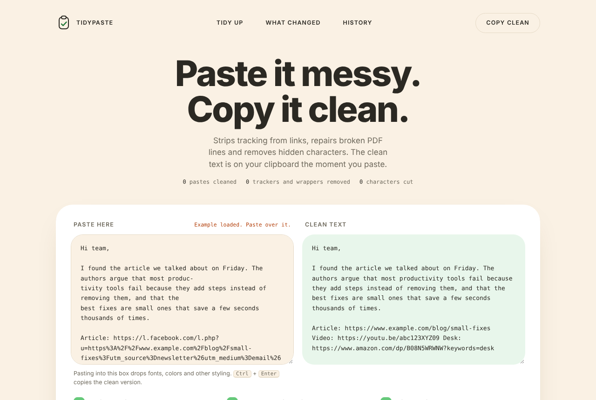
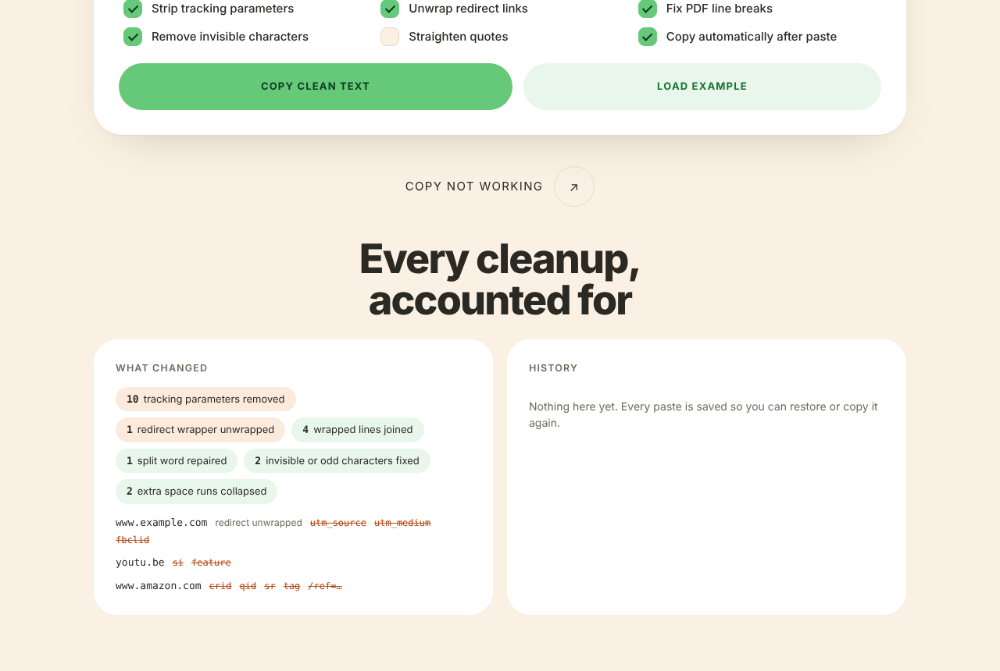
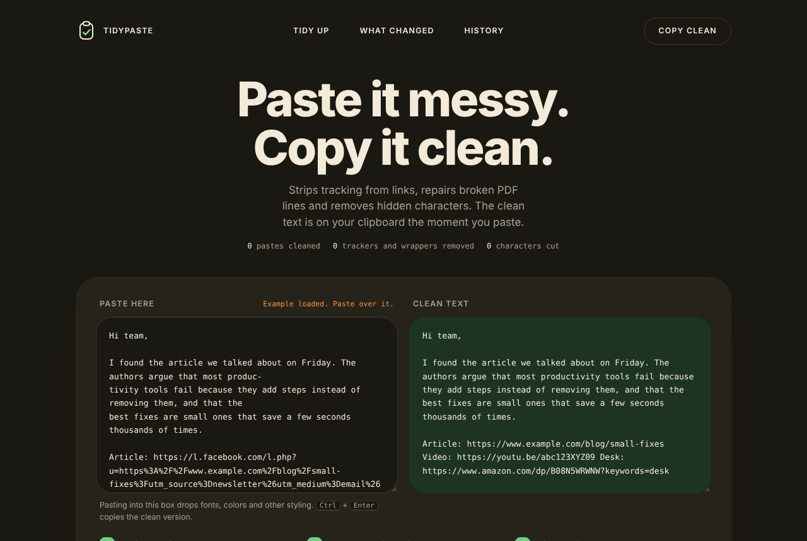
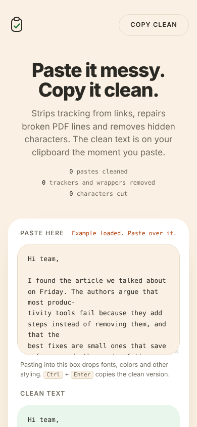

# TidyPaste

Paste messy text or links, get a clean version back, already copied to your clipboard.



## The problem
Links arrive full of tracking junk (`utm_*`, `fbclid`) or wrapped in redirect URLs. Text copied from a PDF breaks mid-sentence and splits words with hyphens. Cleaning that by hand takes a minute every time.

## What it does
1. Removes tracking parameters and unwraps redirect links, and lists what it removed.
2. Repairs PDF line breaks and split words, and removes hidden characters and extra spaces.
3. Copies the clean result automatically on paste and keeps a history to restore or copy again.

Everything runs in your browser. Nothing you paste leaves the page. Each cleaning step can be switched off:

| Option | Default |
| --- | --- |
| Strip tracking parameters | on |
| Unwrap redirect links | on |
| Fix PDF line breaks | on |
| Remove invisible characters | on |
| Straighten quotes | off |
| Copy automatically after paste | on |

## Preview

| What changed and history | Dark mode | On a phone |
| --- | --- | --- |
|  |  |  |

The screenshots show the built-in example that loads on first visit. They were captured without the web fonts, so the real page uses Archivo and Instrument Sans.

## Tech stack
- **HTML5, CSS3 and vanilla JavaScript.** There is no framework, no dependency and no build step.
- **Clipboard API** (`navigator.clipboard`) with an `execCommand('copy')` fallback for browsers that block it.
- **`localStorage`** for the paste history, the option switches and the running totals. It stays on your device.
- **Google Fonts** for the typefaces (Archivo, Instrument Sans, JetBrains Mono).
- Light and dark themes follow your system setting.

## How to run it
There is nothing to install.

**Quickest:** download or clone the repo and open `index.html` in a browser.

```
git clone https://github.com/mqz0211/tidypaste.git
cd tidypaste
```

**Or serve it locally** (closer to how it runs when hosted):

```
python3 -m http.server 8000
```

then open http://localhost:8000.

Paste messy text into the left box. The clean version appears on the right and is copied automatically. Press Ctrl+Enter (Cmd+Enter on a Mac) to copy it again. If your browser blocks automatic copying, use the "Copy clean text" button.

## Files
- `index.html` page structure
- `style.css` design
- `app.js` cleaning logic and UI
- `docs/screenshots/` images used in this README
